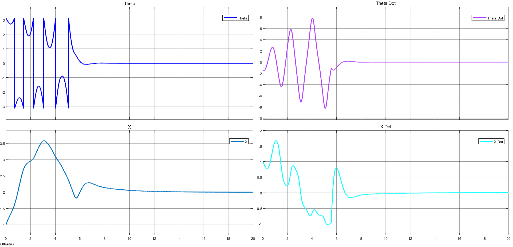

# Cart–Pendulum Energy Shaping

Energy-based swing-up and local stabilization of an underactuated cart–pendulum in MATLAB/Simulink. This thesis project studies partial feedback linearization, energy regulation, an IDA-PBC-inspired local controller, damping injection, and smooth controller blending.

**Author:** Ali Ramezanzadeh  
**Institution:** Amirkabir University of Technology, Department of Electrical Engineering  
**Supervisors:** Dr. Heidar Ali Talebi and Dr. Iman Sharifi  
**Original thesis date:** February 2026

The supplied thesis cover identifies a bachelor's project. Its original English title is *Modeling and Control of Energy-Based Nonlinear Systems Using Energy Shaping Technique*.

## Read the project

- [Ten-page English report](reports/english/thesis-summary.pdf) — a focused technical synthesis with equations, original figures, references, and evidence limits.
- [English LaTeX source](reports/english/thesis-summary.tex) and [figure assets](reports/english/figures).
- [Original Persian thesis](reports/original/thesis-fa.pdf) and [original thesis sources](reports/original/source).
- [Reproduction guide](docs/reproducibility.md), [model notes](docs/model-notes.md), and [source consistency checks](docs/source-checks.md).



*Original recorded swing-up response over 0–20 s. The angle is wrapped at ±π; the cart approaches its reference of 2 m. The figure has been preserved unchanged.*

## Controller and recorded scenarios

The simulation uses the reduced coordinates `q = [theta; x]` and `p = dq/dt`. An energy regulator supplies the swing-up command; a cubic smoothstep blends it with the local controller. The auxiliary cart-acceleration command is clipped to ±10 m/s². The equivalent force is calculated separately as a diagnostic.

| Scenario | Objective | Original display window |
|---|---|---|
| Local stabilization | Approach the upright configuration and zero cart reference from an upper-half-plane state | 0–10 s |
| Swing-up and regulation | Transfer from downward motion to upright regulation with a 2 m cart reference | 0–20 s |
| Disturbance recovery | Recover after three finite pulses in the saved cart-acceleration channel | 0–50 s |

The supplied figures show the intended sequence for these selected nominal trajectories. The largest disturbance produces substantial cart travel and temporary return to swing-up mode.

## What is included

```text
models/                  Original .slx models and .mlx Live Script
scripts/                 Text companion and helpers to initialize/open the model
reports/english/         Ten-page PDF, editable LaTeX, and original figure copies
reports/original/        Original thesis PDF and source material
docs/                    Reproduction, source checks, provenance, and verification
CITATION.cff             Author and project citation metadata
```

`Energy_Shaping.slx` is an exploratory energy/LQR model. `IDA_PBC.slx` contains the combined reduced-coordinate controller and the pulse-recovery setup. The models were saved in R2022b. Their saved configuration is fixed-step auto, a 0.001 s step, and a 50 s stop time.

## Open in MATLAB

Add the repository's `scripts` folder to the MATLAB path, then call:

```matlab
open_project
```

This initializes documented parameters and opens `IDA_PBC.slx`. It does not run a simulation or change the original model. Follow the [reproduction guide](docs/reproducibility.md) before modifying or replaying the scenarios. The exploratory model's symbolic/LQR setup additionally uses Symbolic Math Toolbox and Control System Toolbox.

## Evidence and validation

The original models, thesis, and selected figures are preserved byte-for-byte; an [SHA-256 manifest](docs/original-file-manifest.json) records their provenance. The English report is a synthesis rather than a full translation. MATLAB simulations were not rerun during repository preparation.

Source inspection found differences in angle conventions, initial-velocity routing, the disturbance channel, smoothing width, and desired-energy calculations. The [source checks](docs/source-checks.md) explain these findings. They must be reconciled before claiming exact reproduction, an exactly matched IDA-PBC structure, or a global stability guarantee under saturation. Auxiliary acceleration clipping does not establish physical force or finite-rail feasibility.

## References and citation

The English report cites the supplied thesis and verified publisher records for the foundational work of Ortega et al., Acosta et al., and Chung and Hauser. See [reference notes](docs/references.md) and [CITATION.cff](CITATION.cff). No publication or release is claimed by this repository draft.

